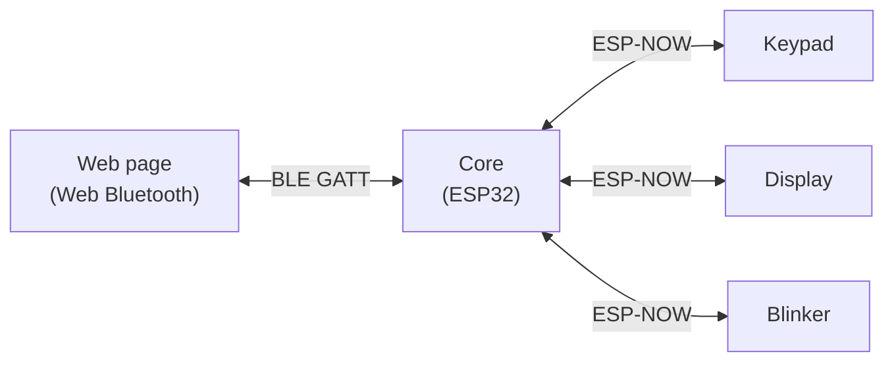
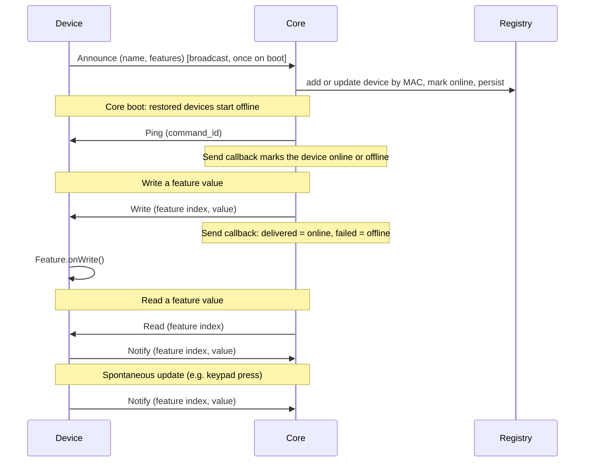
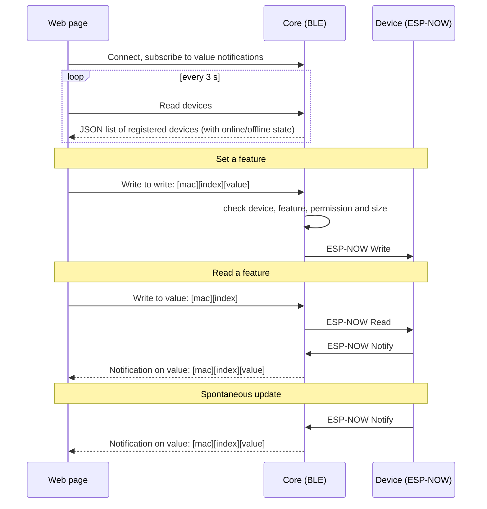

# MandOS

A device ecosystem for cosplays

## Architecture

A **core** (ESP32) keeps a registry of nearby **devices** (ESP32-C3, one firmware per device type) and talks to them over ESP-NOW. A browser can control the core over Bluetooth LE using the Web Bluetooth page in [web/](web/index.html).

### Core ↔ devices (ESP-NOW)

Devices broadcast an announcement once on boot with their name and features. The core builds its registry from them, keyed by MAC address, and saves it to flash (LittleFS, `/registry.bin`). On boot the core restores the registry with every device marked offline and pings them (for ~6 s); a device that answers with an announce, or sends any message, becomes online. Every command (read, write, ping) carries a 16-bit `command_id` from the core; a device echoes the id in the notification answering a read. Devices don't ack commands: the core uses the ESP-NOW send callback, so a command that is not delivered marks the device offline and a delivered one marks it online. Requests go from the core to a device by its MAC. Devices push values to the core as notifications.

### Web page ↔ core (Web Bluetooth)

The core exposes one BLE service with three characteristics. See [src/core/ble_service.h](src/core/ble_service.h) for the payload formats.

## Project layout

| Path | Contents |
| ------ | ---------- |
| `src/core/` | Core firmware (ESP-NOW, BLE and flash persistence of the registry) |
| `src/devices/<name>/` | One firmware per device type |
| `lib/mandos_common/` | Wire protocol and radio setup shared by all firmwares |
| `lib/mandos_core/` | Device registry |
| `lib/mandos_device/` | Device runtime (`MandosDevice`, `Feature`) |
| `web/index.html` | Web Bluetooth control page (shows online/offline badges) |

Each firmware is a PlatformIO environment: `pio run -e core -t upload`, `pio run -e blinker -t upload`, and so on.
